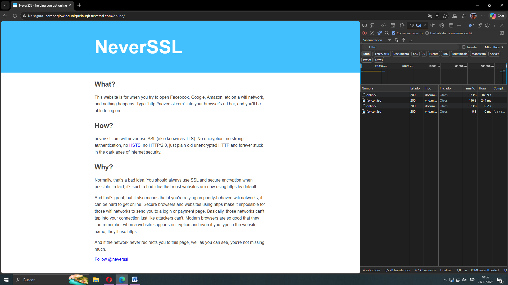
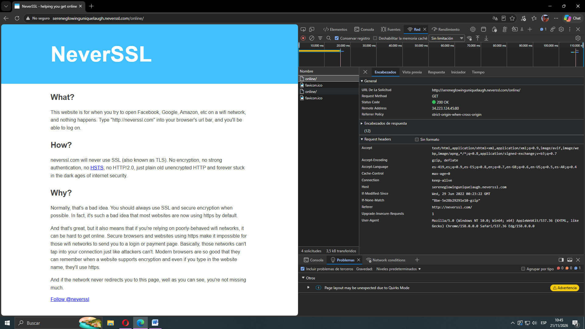

# Informe de Auditoría de Red Wi-Fi Insegura

**Práctica:** Análisis de tráfico HTTP y seguridad en redes públicas
**Alumno:** Bondesio, Geronimo
**Fecha:** 21/11/2026
**Herramienta:** Microsoft Edge DevTools (pestaña Red / Network)
**Sistema operativo:** Windows 10

---

## 1. Introducción

El objetivo de esta práctica es analizar los riesgos de seguridad asociados a la navegación mediante conexiones HTTP en redes Wi-Fi públicas, actuando como auditor de seguridad junior.

Se busca identificar qué información puede observarse durante una solicitud HTTP, comprender las vulnerabilidades de las comunicaciones sin cifrado y analizar cómo una VPN puede contribuir a proteger la privacidad del usuario.

## 2. Sitio analizado

Se realizó una conexión al sitio NeverSSL, diseñado para permitir pruebas de navegación mediante HTTP. Al ingresar, el sitio redirigió a un subdominio generado de forma aleatoria.

- **Sitio:** <http://neverssl.com>
- **Host observado:** `sereneglowinguniquelaugh.neverssl.com`
- **URL solicitada:** <http://sereneglowinguniquelaugh.neverssl.com/online/>
- **Protocolo:** HTTP (puerto 80)
- **Método HTTP:** GET
- **Código de respuesta:** 200 OK
- **Dirección remota:** `34.223.124.45:80`

### 2.1 ¿Qué protocolo utiliza el sitio?

El sitio utiliza **HTTP**, no HTTPS. Esto se comprueba porque la URL comienza con `http://`, la conexión se realiza por el puerto 80 y el navegador muestra la advertencia **«No seguro»** junto a la dirección. En consecuencia, la comunicación entre el navegador y el servidor viaja en texto plano, sin cifrado TLS.

| | HTTP | HTTPS |
|---|---|---|
| Cifrado | No cifra la comunicación | Cifra la comunicación mediante TLS |
| Puerto habitual | 80 | 443 |
| Datos en tránsito | Legibles para quien intercepte el tráfico | Ilegibles para terceros |
| Identidad del servidor | No se verifica | Se verifica mediante certificado |
| Indicador en el navegador | «No seguro» | Candado |

## 3. Evidencia observada

Mediante las herramientas de desarrollador del navegador (F12), en la pestaña Red, se recargó la página y se inspeccionó la primera solicitud realizada al sitio (documento `online/`).

**Datos generales de la solicitud:**

| Dato | Valor observado |
|---|---|
| URL solicitada | `http://sereneglowinguniquelaugh.neverssl.com/online/` |
| Método HTTP | `GET` |
| Código de estado | `200 OK` |
| Dirección remota | `34.223.124.45:80` |
| Referrer Policy | `strict-origin-when-cross-origin` |

**Encabezados enviados por el navegador (Request headers):**

| Encabezado | Valor observado | Información que revela |
|---|---|---|
| Host | `sereneglowinguniquelaugh.neverssl.com` | Sitio al que se conecta el usuario |
| User-Agent | `Mozilla/5.0 (Windows NT 10.0; Win64; x64) … Chrome/158.0.0.0 Safari/537.36 Edg/158.0.0.0` | Navegador (Microsoft Edge), versión y sistema operativo (Windows 10) |
| Accept-Language | `es-419, es, es-ES, en, en-GB, en-US, es-AR` | Idiomas preferidos y región aproximada del usuario |
| Accept | `text/html, application/xhtml+xml, application/xml, image/avif, image/webp …` | Formatos de contenido aceptados por el navegador |
| Accept-Encoding | `gzip, deflate` | Métodos de compresión compatibles |
| Referer | `http://neverssl.com/` | Dirección desde la que se originó la navegación |
| Otros | `Cache-Control`, `Connection`, `If-Modified-Since`, `If-None-Match`, `Upgrade-Insecure-Requests` | Comportamiento de caché y de la conexión |

### 3.1 Información visible durante la solicitud

Al tratarse de una comunicación HTTP, todos los elementos anteriores viajan en texto plano. Los más relevantes son:

- **Host y URL:** indican exactamente qué sitio y qué página se visitan.
- **Método GET:** muestra el tipo de acción que realiza el navegador.
- **User-Agent:** identifica el navegador y el sistema operativo del dispositivo.
- **Accept-Language:** revela los idiomas configurados.
- **Referer:** muestra desde qué página llegó el usuario.

### Capturas de pantalla

*Figura 1. Pestaña Red de Edge DevTools con las solicitudes registradas al cargar NeverSSL (la barra de direcciones indica «No seguro»).*

*Figura 2. Detalle de la primera solicitud: datos generales (URL, método GET, 200 OK, dirección remota) y Request headers.*

## 4. Riesgos encontrados

La utilización de HTTP en redes Wi-Fi públicas puede representar diferentes riesgos de seguridad. Un atacante que consiga interceptar el tráfico de red (por ejemplo, mediante un ataque de intermediario o *Man-in-the-Middle*, o un punto de acceso falso) podría:

- Observar las direcciones y solicitudes realizadas.
- Leer información transmitida sin cifrado.
- Modificar respuestas del servidor.
- Inyectar contenido malicioso en las comunicaciones.

**La información que podría ser interceptada incluye:**

- **Sitios visitados y páginas consultadas:** a través del Host y la URL completa.
- **Datos del dispositivo:** navegador, versión y sistema operativo, tal como figura en el User-Agent.
- **Preferencias del usuario:** idioma y región aproximada (Accept-Language) y página de origen de la navegación (Referer).
- **Credenciales y datos personales:** usuarios, contraseñas y datos de formularios enviados por HTTP viajan en texto plano.
- **Cookies de sesión:** un atacante podría utilizarlas para suplantar al usuario en un sitio.

La ausencia de cifrado permite que la información transmitida sea más vulnerable frente a ataques de intermediario (*Man-in-the-Middle*).

## 5. Cómo ayuda una VPN

Una VPN (*Virtual Private Network* o Red Privada Virtual) establece una conexión protegida entre el dispositivo del usuario y un servidor VPN. Su funcionamiento utiliza los siguientes mecanismos:

- **Cifrado:** transforma los datos para impedir que terceros puedan leer la información interceptada.
- **Túnel seguro:** establece un canal protegido entre el dispositivo y el servidor VPN. Para ello utiliza encapsulamiento: los paquetes originales se introducen dentro de otros paquetes que viajan por la conexión VPN.
- **Protección del tráfico:** en la red Wi-Fi pública solo se ve tráfico cifrado hacia el servidor VPN, por lo que un atacante no puede leer ni modificar las solicitudes, los encabezados ni las respuestas.
- **Privacidad:** dificulta que otros usuarios de una red pública observen los sitios visitados y el tráfico interno de la conexión; los sitios ven la IP del servidor VPN y no la del usuario.

> **Importante:** una VPN no reemplaza HTTPS. La protección del túnel termina en el servidor VPN, por lo que una conexión HTTP puede seguir siendo vulnerable después de ese punto. Lo ideal es combinar ambas medidas.

## 6. Las 3 Reglas de Oro para navegar en redes públicas

1. **Evitar operaciones sensibles:** no realizar operaciones bancarias ni ingresar contraseñas en redes públicas o desconocidas.
2. **Utilizar una VPN confiable:** proteger el tráfico mediante una conexión cifrada.
3. **Verificar los sitios web:** priorizar páginas HTTPS y evitar conexiones que presenten advertencias de seguridad.

## 7. Conclusión

A través de esta práctica se pudo identificar una comunicación HTTP y observar los encabezados transmitidos durante una solicitud real. Se comprobó que el sitio utiliza el método GET, responde con un código 200 OK y transmite información mediante una conexión sin cifrado TLS.

También se comprendió cómo una VPN contribuye a mejorar la seguridad mediante mecanismos de cifrado, encapsulamiento y túneles protegidos.

Como conclusión, la seguridad en redes públicas depende tanto de las herramientas tecnológicas utilizadas como de los hábitos y precauciones del usuario.
